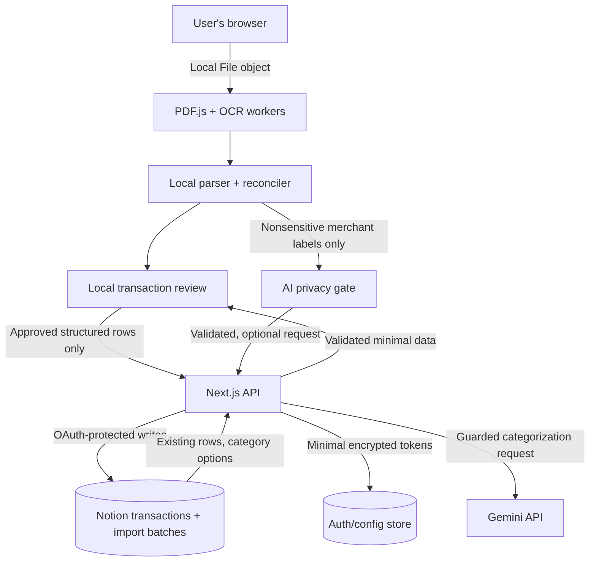

# Notion Expense Importer

**Software Design Document (SDD)**  
**Version:** 1.0  
**Date:** November 4, 2026  
**Status:** Requirements finalized; ready for implementation and iterative validation  
**Primary audience:** Solo developer using Codex; future open-source contributors

> **One-sentence product definition:** A free-first, privacy-conscious, browser-first website that turns credit card statement PDFs into accurate, categorized Notion transactions, makes extraction failures easy to find, and minimizes monthly manual data entry.

---

## 1. Executive summary

The user currently downloads PDF credit card statements, visually reviews them, and manually enters individual financial transactions into a Notion balance sheet. The new product will automate this process while preserving **Notion as the primary financial dashboard and sole persistent transaction store**.

The application is an **importer, not a budgeting replacement**. Users connect their own Notion workspace, use a standardized Notion finance template, upload one PDF statement at a time, and review only suspicious or incomplete results before committing changes to Notion. In a later phase, it will also support photos of receipts.

The application is designed first for one developer using multiple banks, and later for friends and potentially public open-source use. It should require **no mandatory paid service** for a local prototype. It uses local browser PDF parsing and OCR, matching and categorization rules, and an optional Google Gemini component restricted to appropriately nonsensitive data. All financial calculations and final synchronization decisions are deterministic.

### 1.1 North-star outcomes

- Reduce monthly manual work from **45+ minutes to 10 minutes or less**, measured on real statements.
- For a representative 100-transaction statement, aim for **at least 85 transactions requiring no individual edits**, and **no more than 15 requiring review**. This is an initial target, not a cross-bank guarantee.
- Make **unrecognized transaction-like regions visible directly in the PDF**, rather than forcing the user to scan the entire statement to find omissions.
- Avoid duplicate transactions across repeated, overlapping, and interrupted imports.
- Require **zero persistent storage of original bank statement PDFs or standalone financial transaction history on the website's servers**.
- Keep the app useful when Gemini is disabled, unavailable, or out of free quota.

### 1.2 Priorities and tradeoffs

1. **$0 required operating cost** for the personal/local experience.
2. **Reduce manual work** through safe automation and exception-only review.
3. **Financial correctness** takes precedence over guessing or hiding parse failures.
4. **Privacy** through local processing, minimal retained credentials, and transparent third-party data transfers.
5. Support multiple banks immediately through a generic extraction pipeline, while improving bank-specific accuracy incrementally.

These goals can conflict. For example, a strict local-first system may leave certain unusual merchant descriptions uncategorized. The product must prefer a clearly labeled exception to inventing or misplacing money.

---

## 2. Scope

### 2.1 V1: required

- Responsive website with a desktop-first import/review workflow.
- Connect Notion with OAuth; authorize a recommended, standardized Notion template.
- Import **one PDF statement per session** from any bank using a generic extraction approach.
- Support both text-based and scanned PDFs using browser-local OCR when needed.
- Locally extract transaction dates, description, amount, credit/debit direction, and the most accurate available currency fields.
- Identify statement/account where possible; ask for confirmation if uncertain.
- Recognize purchases, refunds, fees, interest, payments, deposits/credits, transfers and unknown transaction types.
- Auto-categorize using Notion category options, existing Notion precedents, local rules and optional permitted Gemini hints.
- Link every parsed transaction to its original PDF page and bounding region whenever possible.
- Show unmatched/uncertain text regions and reconciliation problems directly in the PDF viewer.
- Auto-skip a duplicate only at **very high confidence**; ask about other plausible duplicates.
- Bulk category editing and manual transaction creation from the PDF.
- Final pre-import review showing suspicious transactions; commit approved entries in a controlled sequence.
- Recover from interrupted or repeated imports by querying identifiers stored in Notion.
- Safe import undo via Notion-stored batch identifiers, with an explicit confirmation preview.
- No persistent PDF copies or separate transaction history in the web application.
- Public GitHub repo, documented local development and safe secret handling.

### 2.2 V1.1 / V2: planned

- Receipt photos from iPhone camera or browser share flow; store **merchant, total, date, category**, not line-item breakdown.
- Multiple statement uploads and consolidated review.
- Mobile step-by-step exception wizard.
- User-assisted generic parser mapping for unfamiliar bank layouts.
- Optional native-like progressive web app installation, iPhone Shortcut, or other mobile capture mechanisms.
- Wider distribution to friends and production hosting, subject to security checks and quota constraints.
- Existing custom Notion database mapping, after the standardized-template workflow is stable.

### 2.3 Explicit non-goals

- Replacing Notion as the spending dashboard.
- Maintaining a second financial ledger in the app database.
- Live bank account connection or online banking screen scraping.
- Automatic monthly retrieval of bank statements.
- Conversational chat assistant or AI-powered financial advice.
- Receipt line-item extraction or allocation across multiple purchase categories in V1.
- Writing unreviewed transactions to Notion before exception review.
- Full accounting, taxes, double-entry bookkeeping, or bank reconciliation guarantees.
- A universal guarantee that every possible bank PDF can be parsed without correction.

---

## 3. Users and jobs to be done

**Primary user:** One person with multiple bank-issued credit cards and a Notion finance tracker. Imports statements about once per month; may already have some transactions manually entered.

**Secondary user:** Friends with a free Notion account who want a quick setup using the provided template.

**Core job:** “When I download a credit card PDF, I want the app to extract and correctly classify the transactions, show me exactly which items require attention, and add the rest to Notion without making me type all the entries.”

**Primary scenario:** One user uploads an October PDF with 100 transactions; 85 classify cleanly, 10 have uncertain categories, 3 appear to be duplicates, and 2 are poorly extracted. The reviewer places the 15 exceptions in a compact queue and can jump directly to the two unrecognized PDF regions. Once issues are resolved, user confirms the 85+ approved entries and the app writes them into Notion.

---

## 4. Functional requirements

| ID | Requirement | Priority | Verification |
|---|---|---|---|
| FR-01 | Connect and refresh authorized Notion access | P0 | OAuth integration test |
| FR-02 | Duplicate/use the recommended Notion template | P0 | End-to-end onboarding |
| FR-03 | Validate Notion data-source schema before import | P0 | Schema mutation tests |
| FR-04 | Parse text PDFs in browser | P0 | Fixture-based parser tests |
| FR-05 | OCR scanned PDFs in browser | P0 | Scanned statement fixtures |
| FR-06 | Detect and normalize transaction rows across bank layouts | P0 | Multiple-bank golden fixtures |
| FR-07 | Detect account and statement currency, with confirmation fallback | P0 | Ambiguous account tests |
| FR-08 | Identify and preserve source bounding regions | P0 | PDF visual overlay tests |
| FR-09 | Flag potentially missed transaction regions | P0 | Missing-row fixtures |
| FR-10 | Reconcile against available statement controls | P0 | Totals/balance tests |
| FR-11 | Categorize using Notion categories and prior user choices | P0 | Category regression tests |
| FR-12 | Optionally use permitted Gemini classification hints | P1 | Sanitization and quota tests |
| FR-13 | Identify exact and probable duplicates | P0 | Reimport/overlap tests |
| FR-14 | Bulk edit categories, manually create missing items | P0 | UI interaction tests |
| FR-15 | Review exceptions **before** writing | P0 | End-to-end guard test |
| FR-16 | Commit approved entries with retry-safe Notion writes | P0 | Crash/timeout tests |
| FR-17 | Resume after reupload without duplicate creation | P0 | Partial-write recovery test |
| FR-18 | Preview and undo a selected import batch | P1 | Audit/undo test |
| FR-19 | Keep documents and working transaction objects ephemeral | P0 | Storage/log inspection |
| FR-20 | Add one-time receipt photos | P2 | Image fixture tests |

---

## 5. User journey and interface

### 5.1 Onboarding

1. Open the website.
2. Select **Connect Notion**.
3. Notion OAuth presents the offered template duplication option; user chooses **Use recommended template**.
4. The backend exchanges the OAuth code, validates token scope, finds the newly duplicated template/database, and discovers required data-source IDs.
5. The website checks the schema and shows **Ready to import**.
6. User may return later; OAuth credentials and minimal settings persist, but no past PDFs or imported transactions are cached by the app.

For local development, a trusted internal connection/PAT may be used as a development shortcut, but the production experience must be OAuth-based. Notion's authorization flow supports an optional template duplication step and returns a `duplicated_template_id` when used.

### 5.2 Import wizard

**Step 1: Upload**
- Drag and drop one PDF, or browse for it.
- File type and size validation; explain encrypted, password-protected and corrupted files.
- Display “Processed on your device” status, without promising absolute privacy from all external services.

**Step 2: Inspect**
- Render pages locally, run text extraction, then OCR only where required.
- Show estimated bank, masked account label, period, currency and page count.
- Ask user to confirm/account-map if confidence is insufficient.
- Never infer full card numbers or store unmasked account numbers.

**Step 3: Reconcile**
- Two-pane desktop UI: left original PDF with highlights; right parsed transactions and prioritized exceptions.
- Top summary: pages analyzed, transaction-like regions, parsed rows, matched rows, ambiguous regions, reconciliation status, duplicates, estimated amount totals.
- Selecting a row scrolls/zooms to its source highlight. Selecting an unmatched highlight opens an editable transaction card prefilled from recognized characters.
- PDF overlays: green = confidently represented, yellow = uncertain/unmatched, red = contradictory/malformed, gray = known nontransaction material.
- Keyboard operations: next issue, approve, edit, skip, add missing row; screen-reader alternatives for all colors.
- Bulk select/filter by category, account, merchant, transaction type and validation reason.

**Step 4: Final preview**
- Clearly separate **Will add**, **Will skip as duplicate**, **Needs user decision**, and **Excluded non-expense transaction type**.
- User must resolve blocking issues or explicitly mark a partial import and acknowledge unresolved lines.
- No write occurs before the user confirms.

**Step 5: Sync**
- Show a progress counter for Notion writes with success, already-exists, retrying, and failed counts.
- Support safe cancellation between writes; never imply an all-or-nothing commit.
- On completion, show direct links to the created Notion records and batch summary.
- On error/crash: ask the user to reupload the same file. The system re-queries Notion before each pending creation and skips confirmed records.

### 5.3 Return visits

- User sees **Connect/Connected to Notion** and **Start new import**, not a historical transaction dashboard.
- Optional **Undo a past import** can list batch metadata *queried live from Notion*; it does not require a website-hosted finance database.
- Local browser state is cleared on tab close/refresh; user reuploads to recover an interrupted workflow.

### 5.4 Mobile behavior

V1 is responsive but desktop-optimized. On narrow screens use a transaction list and on-demand PDF preview. In V2 provide a guided one-at-a-time exception wizard. PDF OCR on mobile may be slower and should display progress, memory warnings and cancellation.

---

## 6. System architecture

### 6.1 Recommended stack

| Layer | Choice | Why |
|---|---|---|
| Web framework | Next.js App Router + TypeScript | Single full-stack language; server endpoints for OAuth and API calls |
| UI | React + Tailwind CSS | Responsive document reviewer |
| Validation | Zod | Shared contract validation |
| PDF display/text | PDF.js (`pdfjs-dist`) | Browser rendering, text extraction, page coordinate mapping |
| Browser OCR | Tesseract.js + WASM worker | Scanned PDFs without uploading raw statements |
| Parsing engine | Pure TypeScript modules | Deterministic, testable, browser-native |
| Local state | React state + optional Zustand | Current import only; in-memory, no financial persistence |
| Exact amounts | Integer minor units + ISO currency metadata | Avoid floating-point classification and reconciliation drift |
| Notion integration | Official Notion SDK or version-pinned REST API | Predictable schema reads/writes |
| AI | Optional Gemini API behind a guarded server route | Merchant/category hints on approved nonsensitive inputs |
| Auth/config storage | Encrypted credentials + session records only | Required for reconnecting Notion; no statement ledger |
| Tests | Vitest, Playwright, fixture-based golden tests | Parser, import and UI correctness |
| Deployment | Local Next.js app initially; hosted later | No required production hosting charge in V1 |

**Do not add FastAPI by default.** Python can be useful for offline benchmarking and fixture research, but the production import pipeline should remain TypeScript-first unless profiling demonstrates a compelling need for a separate service.

### 6.2 Trust boundaries



**No raw PDF bytes or page images cross the browser-to-server boundary in V1.** PDF text, detected coordinates and working rows remain transient in browser RAM. Approved transaction records necessarily cross the server boundary to be written to Notion. Existing Notion transactions may be queried and temporarily returned to the authenticated browser for matching, but must not be persisted on the website.

### 6.3 Modules

- `pdf-renderer`: PDF load, canvas rendering, zoom, page transforms and source overlay.
- `text-extractor`: PDF.js text-token extraction and geometry.
- `ocr-worker`: scanned page recognition with confidence and geometry.
- `layout-analyzer`: identifies transaction regions, headers, totals, footers and unconsumed row candidates.
- `generic-transaction-parser`: row grouping, date/amount/direction detection, field normalization.
- `bank-layout-hints`: optional signature-based enhancements; **generic baseline always remains available**.
- `reconciliation-engine`: math controls, row coverage and quality gates.
- `categorization-engine`: local rules, Notion prior examples, optional Gemini hints.
- `dedupe-engine`: exact-import IDs, existing Notion matching and ambiguous-match queue.
- `notion-schema-adapter`: template version/schema lookup, mapping and safe writes.
- `notion-sync`: commit queue, retry checking, partial failure recovery and undo.
- `auth`: OAuth code/state flow, encrypted tokens, refresh, session enforcement.
- `gemini-privacy-gate`: applies strict content allowlist and validates model JSON output.

---

## 7. PDF extraction and coverage verification

### 7.1 Two-stage pipeline

**Text-native PDFs:** Use PDF.js to extract text items with bounding geometry, page identifiers, rotation and reading order. Normalize whitespace, hyphens, unicode currency markers and date variants. Group tokens into lines and lines into candidate transaction rows based on visual alignment, not string order alone.

**Scanned/image-only PDFs:** Render pages to canvases using PDF.js and pass images to a browser-local Tesseract.js worker. Record OCR word/line bounding boxes and confidence. Apply deskew, contrast/threshold and rescaling locally as needed. Tesseract.js does not directly accept PDF files: PDF.js must render the page image before OCR.

Avoid rerunning OCR over text-native pages unless a local quality check shows poor text coverage.

### 7.2 Generic multi-bank extraction strategy

The generic engine must handle common statement patterns without hardcoded bank names:

1. Detect transaction sections using headings, repeated columns, date patterns, aligned debit/credit amount fields, and amount signs.
2. Determine transaction start and end based on region geometry, repeated rows and account/summary sections.
3. Infer date locale and statement year; preserve an uncertainty flag for ambiguous dates.
4. Identify one or two dates per transaction (purchase and posting) and determine which is which.
5. Support two-column debit/credit layouts, parentheses for negatives, trailing minus, localized separators and transaction descriptions spanning multiple lines.
6. Recognize header/footer totals, payments, credits, balance forward, interest and explanatory text separately from purchase rows.
7. Preserve every candidate row and its PDF provenance, including candidates the parser cannot fully normalize.
8. Apply optional bank-layout hints only when a signature matches with high confidence; fall back to generic extraction otherwise.

A truly universal parser is not possible to guarantee. The product should support unknown bank PDFs via a generic fallback and a transparent “unsupported or uncertain region” workflow.

### 7.3 Missing-row visibility (critical UX)

**Problem:** Knowing that 78 of 80 rows were extracted is useless unless the user can instantly find the other 2.

**Solution:** Compare two independently generated structures:

- **Visual transaction candidates:** all PDF regions that visually resemble a transaction line, even if the row parser cannot interpret them.
- **Structured parsed transactions:** rows that successfully produced date, description, amount and type.

Mark every candidate as `matched`, `unmatched`, `ambiguous`, or `intentionally_excluded`. Directly highlight unmatched/ambiguous regions and offer **Create Transaction From Selection**. Also provide a one-click **Next unresolved region** action.

**Important limitation:** A completely invisible or incorrectly segmented row may escape both candidate detection and parsing. Therefore show a confidence/coverage label, not a false statement that every transaction was found. Where balances and summary totals exist, use those as independent reconciliation controls.

### 7.4 Reconciliation rules

- When statement-specific equations are trustworthy, check: opening balance + purchases + fees + interest − payments − refunds/credits ± adjustments = closing balance, using the statement's indicated signs/conventions.
- For a statement listing debits/credits by column, verify the candidate row totals against displayed debit/credit totals when those are present.
- Compare detected transaction count with explicitly stated counts where available.
- Separate mathematical disagreement from categorization uncertainty.
- If a control fails, flag the affected statement/section and block full automatic approval. Allow a user-reviewed partial import with explicit acknowledgment, rather than silently dropping lines.
- Do not claim coverage on statements that provide no trustworthy independent controls. Show “not independently verified” instead.

### 7.5 Confidence model

Use separate confidence scores and rule flags for:

- **Source text confidence** (OCR/text token evidence)
- **Row detection confidence** (transaction-looking region)
- **Field extraction confidence** (date, amount, description, direction)
- **Type confidence** (purchase/refund/payment/transfer/etc.)
- **Category confidence** (merchant classification)
- **Duplicate-match confidence** (identity versus similarity)
- **Overall importability** (derived policy, not merely an AI probability)

Never use one aggregate AI confidence value to authorize a financial write. Critical fields and totals must pass deterministic validation. Make thresholds configurable and calibrate them on test fixtures, not arbitrary percentages.

---

## 8. Transaction model and financial semantics

The browser holds a normalized in-memory `ParsedTransaction` with this conceptual shape:

```ts
type TransactionType =
  | 'purchase' | 'refund' | 'payment' | 'transfer'
  | 'fee' | 'interest' | 'deposit' | 'adjustment' | 'unknown';

type Money = {
  amountMinor: string;  // integer string; prevents JS float drift
  currency: string;     // ISO 4217, e.g. CAD, USD
  exponent: number;     // derived from currency, with explicit exceptions
};

type PdfAnchor = {
  page: number;         // 1-based
  bbox: [number, number, number, number]; // normalized coordinates
  tokenIds?: string[];
};

type ParsedTransaction = {
  temporaryId: string;
  accountNotionPageId?: string;
  transactionDate?: string;
  postingDate?: string;
  rawDescription: string;
  normalizedMerchant?: string;
  transactionType: TransactionType;
  billedAmount: Money;       // the statement ledger amount
  originalAmount?: Money;    // when FX details are printed
  categoryNotionOptionId?: string;
  source: 'statement_pdf' | 'receipt' | 'manual_fix';
  sourceAnchor?: PdfAnchor;
  confidence: Record<string, number>;
  flags: string[];
  sourceDocumentHash?: string;
  sourceRowId?: string;
  dedupeFingerprint?: string;
  reviewStatus: 'ready' | 'needs_review' | 'skip' | 'approved';
};
```

**Currency handling:** Store billed amount and billed currency separately from original amount and original currency if the statement reports both. Do not invent FX rates. Reconcile using billed amounts, not original foreign-currency values.

**Transaction sign semantics:** Prefer a nonnegative magnitude and explicit type/direction when writing Notion. Income/refunds/credit card payments must not be misrepresented as purchase expenses. If Notion formulas need a signed ledger value, use a formula based on type or a documented signed amount property. Credit card payments should normally be excluded from expense totals, but remain visible as transaction-type records when imported.

**Amount storage:** In TypeScript parse and sum using integer minor units (or a decimal library for nonstandard cases). Notion number properties accept numeric values, so conversion to decimal occurs only at the API boundary and must be covered by precision tests.

---

## 9. Categorization engine and Gemini integration

### 9.1 Classification order

1. **Exact Notion precedent:** Where past records for the same normalized merchant and account context consistently use one category, reuse it.
2. **Known local rules:** Merchant canonicalization, recurring patterns and transaction-type rules.
3. **Heuristics:** Generic categories such as Retail, Groceries, Dining, Transportation, Utilities and Subscriptions.
4. **Gemini (optional):** For sanitized, nonsensitive labels only; choose among allowed generic categories.
5. **Fallback:** Best defensible broad category (e.g., Retail or Other), with a transparent confidence/uncertainty marker; surface review if a high-impact ambiguity remains.

Notion is the source of truth for category names/options. Read the current Notion schema each session. Do not keep a user-category database on the website. User corrections influence future imports by their appearance in Notion's transaction history.

### 9.2 Gemini usage policy

Google's unpaid Gemini API terms (effective March 23, 2026) state that users should not submit sensitive, confidential or personal information to unpaid services and note possible use of content for product improvement and review. Therefore **never send raw bank statement PDFs, receipt images, amounts, dates, personal transaction histories, account data, payment identifiers, or transaction descriptions containing personal details to the free Gemini API**.

The optional free-tier route may only receive a tightly restricted input such as a sanitized, common public merchant label together with generic category choices. A privacy gate must reject input with possible personal details, sensitive businesses, account numbers, addresses, references, phone numbers or untrusted free text. Because sanitization is not foolproof, fail closed and use local classification whenever uncertain.

For later distribution or paid processing, document and re-evaluate service terms, disclosure, user consent and available privacy-protective commercial terms before expanding AI input. Do not promise the free tier is an unrestricted financial-document processor.

### 9.3 Gemini response contract

Input example (allowed only if sanitized and judged nonsensitive):

```json
{
  "merchantLabel": "SPOTIFY",
  "allowedCategories": ["Subscriptions", "Dining", "Retail", "Other"],
  "task": "suggest_category"
}
```

Expected schema:

```json
{
  "canonicalMerchant": "Spotify",
  "suggestedCategory": "Subscriptions",
  "confidence": "high"
}
```

- Use structured JSON output where supported, with server-side Zod validation.
- Map suggested category strictly to an existing Notion select option; reject hallucinated categories.
- Never let Gemini create Notion records or perform currency math.
- Batch/deduplicate repeated generic merchant labels to conserve quota.
- Never expose the Gemini API key to browser JavaScript; call through a locked-down server endpoint.
- Apply per-session/IP/user quota controls, no raw prompt logging, 429 backoff and local fallback.
- Record no financial prompt/response history on the backend.

### 9.4 Offline and error behavior

If Gemini is disabled, the privacy gate rejects input, the model is unavailable, or free quota is exhausted: continue the entire import locally. Label unresolved category suggestions honestly rather than blocking synchronization.

---

## 10. Notion template and data mapping

### 10.1 V1 distribution model

Supply an official, versioned **Notion Personal Finance Dashboard** template. During OAuth, the user can duplicate the template and authorize access to it. V1 supports **the supplied template only**, with a schema validation/recovery screen if a required property is changed. Custom unrelated Notion trackers are out of scope until a later phase.

Design the template so all financial data belongs in Notion, with three related data sources:

1. **Transactions:** Every purchase, credit, refund, fee, payment or adjustment.
2. **Accounts:** Named cards/banks and primary billed currency.
3. **Imports:** Metadata about imported statements/batches for deduplication, status, and undo. **No PDF files are stored here.**

Optional native views/rollups: current month, by category, by account, income vs expense and spending summaries. These are Notion views and formulas, not calculations maintained in the website database. Avoid claiming full native chart availability on every free plan; provide table, calendar and grouped views as the guaranteed baseline.

### 10.2 Transactions data-source schema

| Property | Notion type | Required? | Notes |
|---|---|---|---|
| Name | Title | Yes | Normalized merchant or transaction label |
| Transaction Date | Date | Yes, when available | Purchase date |
| Posting Date | Date | Optional | Statement posting date |
| Type | Select | Yes | Purchase/refund/payment/transfer/fee/etc. |
| Category | Select | Yes | Can be user-edited; app reads current options |
| Account | Relation to Accounts | Yes | Identifies card/bank and supports matching |
| Billed Amount | Number | Yes | Nonnegative statement amount |
| Billed Currency | Select | Yes | CAD, USD, etc. |
| Original Amount | Number | Optional | FX source amount when shown |
| Original Currency | Select | Optional | Source currency |
| Description | Rich text | Optional | Preserve relevant sanitized statement label |
| Source | Select | Yes | Statement PDF, receipt, manual fix |
| Import Batch | Relation to Imports | Yes for PDF imports | Undo and traceability |
| Source Row ID | Rich text | Yes for PDF imports | Stable row identifier within batch |
| Fingerprint | Rich text | Yes for PDF imports | Normalized dedupe key |
| Review Note | Rich text | Optional | Human corrections |

The original statement should not be attached to Notion automatically. When adding receipt photos in a later phase, attachment behavior should be explicit and respect plan/file-size limits.

### 10.3 Accounts schema

| Property | Type | Notes |
|---|---|---|
| Account Name | Title | User nickname, e.g. “Main Visa” |
| Institution | Text | Optional label |
| Account Type | Select | Credit card, chequing, etc. |
| Last 4 | Text | Optional, never full number |
| Primary Currency | Select | Billed currency |
| Active | Checkbox | Hidden/closed account support |

If account detection is uncertain, ask the user to choose from existing Accounts or create one.

### 10.4 Imports schema

| Property | Type | Notes |
|---|---|---|
| Batch Name | Title | E.g., “Main Visa - October 2026” |
| Batch ID | Text | UUID generated at import commit |
| Statement Hash | Text | SHA-256 of original file bytes, computed in browser |
| Account | Relation | Target account |
| Period Start / End | Date | When detectable |
| Status | Select | In progress / partial / complete / undone |
| Created On | Created time | Automatically provided |
| Expected/Imported/Skipped/Failed counts | Number | Audit summary; updated during commit |
| Template Version | Text | Schema migration helper |

**Privacy note:** Cryptographic hashes and metadata are not bank statements, but still provide linkable information; treat them as sensitive metadata inside the user's authorized Notion workspace.

### 10.5 Schema compatibility and version pinning

- Use Notion's modern **data-source** model. A database is a container; the data source holds row schema.
- Pin the integration to a reviewed Notion API version, initially `2026-03-11`, and update intentionally with integration tests.
- Resolve IDs and data-source property IDs at setup and revalidate before each import.
- Detect deleted or wrong-typed required properties and offer clear manual restoration guidance. Never silently overwrite the user's schema.
- Build template migrations as explicit, versioned operations; avoid automatic broad write access.
- Check that users have granted access to the relevant page/data source and handle authorization revocation gracefully.

---

## 11. Duplicates, idempotency, partial failure and undo

### 11.1 Levels of matching

**Tier 1: Same source statement**
- Compute a browser-local SHA-256 of the uploaded file bytes (`statementHash`).
- Assign `sourceRowId` using account/statement identity plus deterministic visual row ordering and normalized row content (with a duplicate occurrence index).
- Before creating a row, query Notion for the corresponding batch/source marker. If found, **auto-skip** as an already imported record.

**Tier 2: Different file, same transactions**
- Compare across Notion rows within a bounded relevant date window and account.
- Use amount, currency, posting date, normalized merchant, transaction type, and any stable bank reference.
- For only extremely high-confidence matches (e.g., same stable issuer transaction reference and account), auto-skip.
- Equal amount+merchant+near date is **not sufficient** to auto-skip; queue for user confirmation.

**Tier 3: Unknown relationships**
- Show candidate existing Notion matches side by side and let the user select **Already recorded**, **Add separately**, or **Replace/Update** (update can be deferred beyond V1 if risky).

**Important:** Notion does not provide a database-level uniqueness constraint or multi-row transaction guarantee. Application-side requery and single-active-import per connection reduce duplicates but cannot create an absolute atomic exactly-once guarantee. The UI must be honest about this and expose duplicate recovery tools.

### 11.2 Commit protocol

1. Final review and user confirmation.
2. Re-fetch the latest target Notion schema and matching existing rows.
3. Create/identify the import batch in Notion.
4. Serialize writes for the workspace/connection; avoid concurrent commits for the same account.
5. For each approved candidate: recheck durable Notion identifiers; create only if absent; capture returned Notion page ID.
6. On timeouts or uncertain results, query Notion by source identifier before retrying a create.
7. Update batch count/status as progress is confirmed.
8. End with summary of created, skipped, failed, unresolved, and linked Notion records.

On browser crash, the user reuploads the same statement. The app recomputes identifiers and performs a new Notion preflight; previously created rows are detected and skipped. Any uncertain outcome is shown for review.

### 11.3 Undo protocol

1. User selects an **Imports** batch queried live from Notion.
2. App finds Transactions related to that batch, including any modified since creation.
3. Show exact affected records, totals, and a warning for edited/shared records.
4. User explicitly confirms.
5. Prefer moving app-created records to Notion trash (reversible according to current Notion behavior) over permanent deletion; mark batch Undone.
6. Never modify a record from a different batch or manually created record by mistake.

---

## 12. API design (server side)

All backend endpoints require a valid authenticated session except the initial OAuth start/callback. The browser sends **structured JSON only** after parsing; no PDF or image upload API exists in V1.

| Method | Route | Purpose |
|---|---|---|
| GET | `/api/auth/notion/start` | Create state, redirect to Notion OAuth |
| GET | `/api/auth/notion/callback` | Validate state, exchange code, save encrypted tokens, establish session |
| POST | `/api/auth/logout` | Revoke session; optionally disconnect integration |
| GET | `/api/notion/status` | Current connection and workspace metadata |
| GET | `/api/notion/schema` | Data-source metadata and template version |
| GET | `/api/notion/accounts` | Authorized account options |
| GET | `/api/notion/categories` | Current Notion category options |
| POST | `/api/notion/existing-transactions/query` | Bounded server-side match lookup; no storage |
| POST | `/api/imports/preflight` | Validate candidate batch and duplicate risks |
| POST | `/api/imports/commit-chunk` | Validate and write a bounded chunk of approved transactions |
| GET | `/api/imports/:batchId` | Query Notion for batch status |
| POST | `/api/imports/:batchId/undo-preview` | Show exact Notion records proposed for trashing |
| POST | `/api/imports/:batchId/undo` | Execute confirmed undo |
| POST | `/api/ai/classify` | Privacy-gated Gemini merchant-category suggestion |

### 12.1 API security contracts

- Session cookie: HTTP-only, Secure in production, appropriate SameSite, server-issued random ID, short TTL and rotation.
- OAuth `state` is unpredictable, tied to session, and checked at callback.
- Protect write endpoints against CSRF and enforce same-origin request policy.
- Every API call resolves the authorized Notion connection server-side; never trust a browser-supplied workspace or data-source ID without ownership validation.
- Validate all JSON bodies with Zod, cap row count per chunk and request size, reject unknown properties.
- Never return Notion access or refresh tokens to browser JavaScript.
- Rate-limit Gemini and commit requests per session; prevent concurrent imports to the same workspace during the prototype.
- No file uploads to backend and no request/response logging of transaction bodies.
- Responses return only minimal status and created page IDs necessary for the current session.

### 12.2 Chunked write model

Use small chunks (for example 10–20 records), serialized as appropriate, so serverless request timeouts and rate limits do not require a long-lived server job. Client can reconnect and requery Notion after a failure. The backend must verify each write against Notion before unsafe retries.

Notion imposes rate limits; as documented in November 2026, Free/other non-Business plans have a per-connection budget of **180 requests per minute**, with separate workspace and query limits. Handle HTTP 429/529 and `Retry-After`, rather than hardcoding a fixed throughput assumption.

---

## 13. Security and privacy design

### 13.1 Data retention matrix

| Data | Browser | App backend | Notion | Gemini free tier |
|---|---|---|---|---|
| Original PDF bytes | RAM only; discarded after session | Never | Never | Never |
| OCR text / PDF page crops | RAM only | Never | Never | Never |
| Working transaction list | RAM only | In-flight write payload only | Approved records | Never |
| Prior Notion transaction samples | RAM only for dedupe | In-flight proxy only | Already resides there | Never |
| Standard categories | Session | In-flight/optional nonfinancial config | Persistent | Allowed only if nonsensitive |
| Sanitized generic merchant label | Session | In-flight route | Optional as merchant | Only if privacy gate approves |
| OAuth tokens | Never exposed to JS | Encrypted at rest | Issued by Notion | Never |
| Import batch metadata | Session | In-flight only | Persistent | Never |

**No persistent history** means **no website financial ledger or document archive**. It does **not** mean zero network exposure, zero data retention by Notion, or zero app-side credential storage. An authenticated backend must persist some encrypted authentication/session settings.

### 13.2 Controls

- HTTPS for any public deployment; secure local OAuth callback configuration during development.
- Encrypted access/refresh tokens and key rotation procedures.
- Avoid capturing raw financial payloads in logs, analytics, error-reporting SDKs, tracing or crash dumps.
- Hard-limit input file size and page count; protect PDF parser/OCR workers from resource exhaustion.
- Strong browser-side isolation and avoid `innerHTML` for untrusted extracted text.
- Sanitize names/notes before rendering and bound text length for Notion writes.
- Allow user to disconnect Notion and delete server-side connection data.
- Public deployment requires threat modeling for cross-user data leakage, CSRF, session fixation, OAuth callback misuse, SSRF via URLs, prompt injection, and account connection mix-ups.
- Do not claim that browser-local extraction alone makes the entire service private. Be explicit that approved transactions are sent to the app backend and Notion.

### 13.3 Gemini policy gate

Free-tier Gemini is **not** a destination for bank statements or sensitive transaction details. Even user consent does not override the provider's usage terms. Use local processing by default and send only provably generic, nonsensitive merchant classification input through the guarded endpoint; otherwise skip the call. Show a short user-facing notice explaining when third-party AI is used.

---

## 14. Reliability and edge cases

| Scenario | Required behavior |
|---|---|
| PDF contains selectable text | Local text extraction, no OCR unless needed |
| Scanned PDF | Render pages locally and OCR in workers |
| Password-protected PDF | Clear request to provide a decrypted file locally; do not upload for decryption |
| Wrong bank/account identification | User confirmation before review and import |
| Missing amount or ambiguous sign | Flag source region and require correction |
| Missing row not found by row parser | Highlight candidate region and allow create-from-selection |
| Row not detected by any algorithm | Show reconciliation limitation; cannot guarantee detection |
| Purchase + refund | Treat as separate related financial events unless explicitly matched |
| Credit card bill payment | Keep distinguishable as payment, exclude from purchase expense totals |
| Foreign currency entry | Preserve original and billed amounts, use billed for reconciliation |
| Overlapping statements | Cross-file Notion matching and review |
| Exact PDF reupload | Source hash and row markers skip already imported transactions |
| Two same-amount purchases | Avoid collapsing them without strong identity evidence |
| Notion template property renamed | Resolve stable property ID; validate schema and guide repair |
| Notion access revoked | Show reconnect prompt; do not retry with stale credentials indefinitely |
| Notion 429/529 | Respect `Retry-After` and retry safely |
| Notion timeout during create | Requery record marker before attempting write again |
| Browser crashes mid-import | Reupload + Notion source-marker preflight |
| Gemini unavailable | Local category fallback, import continues |
| User edits imported Notion record | Undo preview makes modification visible; never silently delete without confirmation |

---

## 15. Nonfunctional requirements

- **Performance:** A normal text-based monthly statement should reach the review screen quickly on a recent desktop; OCR may be slower. Measure p50/p95 on representative devices instead of promising an unvalidated SLA.
- **User effort:** Representative 100-row statement should require no more than 15 individually reviewed rows and under 10 minutes of active user time, once the parser has been calibrated against the represented bank layouts.
- **Correctness:** No unreviewed critical-field ambiguity may be silently committed. Reconciliation failures must be surfaced.
- **Accessibility:** Full keyboard workflow, high-contrast status indications, non-color visual labels, screen-reader table navigation.
- **Observability:** Aggregate anonymous counters and timings only if explicitly enabled; no raw financial payloads in logs. Local development diagnostics should redact sample values.
- **Security:** Sensitive credentials server-only, encrypted, never included in open-source repository.
- **Portability:** Architecture should support future hosted multi-user operation, but local development must work without third-party paid hosting.
- **Interoperability:** Work with current Notion data-source version and maintain controlled version migrations.

---

## 16. Testing and measurement

### 16.1 Test datasets

Use **both synthetic statements and carefully anonymized real statement samples** from several banks. Preserve formatting, columns, and tricky line structures in the anonymized samples. Do not commit real account numbers, real names, unredacted bank documents or sensitive transaction histories to the public repository.

A golden dataset must contain:

- Original PDF fixture and expected bank/statement/account metadata.
- Ground-truth transaction list with date, amount, currency, type and expected bounding region.
- Expected category options for a mock Notion workspace.
- Reconciliation controls when available.
- Expected duplicates and exceptions.
- A fixture privacy classification (safe synthetic vs restricted local private fixture).

### 16.2 Metrics

- **Row detection recall:** Correctly detected transaction rows / ground-truth rows.
- **Row detection precision:** True transaction rows / all detected candidate rows.
- **Critical-field accuracy:** Exact match rate for amount, direction, date and currency.
- **Coverage verifiability:** Share of statements whose completeness can be independently checked.
- **Auto-processing rate:** Rows approved without individual user edits / eligible rows.
- **Exception-review duration:** Active time spent reviewing and correcting.
- **Duplicate false-positive rate:** Real transactions incorrectly skipped as duplicates.
- **Duplicate false-negative rate:** Duplicates incorrectly inserted.
- **Recovery success:** Rerun after simulated partial commit does not create additional duplicate rows.
- **Privacy leakage tests:** No raw PDF/OCR/personal transaction payload in Gemini or application logs.

### 16.3 Acceptance gates

**Gate A, PDF engine:** Correct field normalization and geometry on at least three structurally different synthetic bank layouts; scanned and text-native variants. Unmatched candidate regions can be opened directly in PDF viewer.

**Gate B, financial correctness:** Reconciliation failure is detected for intentionally removed/modified rows; test suite verifies refunds, credit card payments, FX, date ambiguity and two identical merchant purchases.

**Gate C, Notion safety:** Reuploading after interrupted writes creates no duplicates in tested serial scenarios; schema breaks fail clearly; undo affects only approved batch records.

**Gate D, workflow value:** In timed realistic evaluations, achieve under 10 minutes active user work and 85% or better no-individual-edit auto-processing on **supported representative fixtures**. Track metrics by bank/layout and explicitly mark unsupported layouts.

**Gate E, privacy:** A network inspection shows raw PDF bytes, OCR text and individual sensitive transactions never reach the server except structured approved transactions destined for Notion; Gemini receives only approved nonsensitive labels.

---

## 17. Implementation roadmap and Codex work packages

### Milestone 0: Repository and contracts

- Bootstrap Next.js/TypeScript/Tailwind, linting, Vitest and Playwright.
- Create package/module boundaries and normalized transaction Zod schema.
- Build synthetic sample PDF fixtures and expected JSON ground truth.
- Set up `.env.example`, secret scanning and CI.

**Done when:** Fresh checkout boots locally and baseline tests pass.

### Milestone 1: Local universal PDF extraction

- PDF.js rendering with local-only file handling.
- Text token/geometry extraction and generic row grouping.
- Normalize dates, amounts, credit/debit directions and multiline descriptions.
- Track candidates and source anchors.

**Done when:** At least three synthetic bank layouts parse into normalized data and highlighted PDF regions.

### Milestone 2: Scanned PDF OCR and coverage UI

- Add Tesseract.js worker pipeline and PDF canvas rendering for OCR.
- Candidate-to-row matching and unmatched overlays.
- Side-by-side desktop review and create-from-selection interaction.
- Build reconciliation checks and clear coverage status.

**Done when:** User can find, inspect and correct intentionally omitted/ambiguous rows without manually scanning the whole PDF.

### Milestone 3: Notion template and connection

- Publish standardized Notion template with Transactions/Accounts/Imports data sources.
- Implement OAuth code/state/refresh, encrypted tokens, session cookie.
- Discover duplicated template and validate schema; read categories/accounts.
- Add first safe single transaction insert using version-pinned Notion API.

**Done when:** Test user authorizes a free Notion workspace and sees a correct row in their own template.

### Milestone 4: Categorization and duplication

- Notion precedent-based category classifier and local rules.
- Source hash, row IDs, fingerprinting and Notion preflight.
- Exact duplicate skips; ambiguous duplicates to exception queue.
- Bulk category actions and account selection.

**Done when:** Reupload and overlapping statement fixtures do not silently corrupt the ledger.

### Milestone 5: Controlled commit, recovery and undo

- Final approval gate.
- Chunked writes and per-connection rate control.
- Requery-before-retry for uncertain write outcomes.
- Notion Imports journal, batch counts, recovery, undo preview and trash operations.

**Done when:** Simulated browser/network crash at row 35/100 can be recovered by reuploading, without creating duplicates in tested scenarios.

### Milestone 6: Gemini optional enhancement

- Add sanitized merchant-label privacy gate and model adapter.
- Enforce request quotas, JSON validation and local fallback.
- Benchmark category impact against no-AI baseline; disable if it does not improve accuracy or review time.

**Done when:** No sensitive data can pass the privacy gate in the defined tests, and failed/429 Gemini calls do not prevent imports.

### Milestone 7: Release quality

- Accessibility, mobile responsive layout, error handling, schema repair screen.
- Synthetic and anonymized multi-bank regression fixtures.
- Timed tests against 85% automation and <=10-minute active review target.
- User-facing privacy policy, README, setup instructions and open-source license.

**Done when:** Local single-user MVP meets agreed gate thresholds on evaluated fixtures and known limitations are documented.

### Future milestone: Receipt photos and public sharing

- Browser image capture and local image processing.
- Extract merchant/total/date/category only; attach image to Notion only when deliberately enabled.
- Add dedicated receipt-vs-statement matching.
- Conduct public multi-tenant security review; deploy separate encrypted auth/config store and concurrent import protection.
- Reconsider Gemini key ownership and hosted spending/quotas before inviting friends.

---

## 18. Proposed repository structure

```text
notion-expense-importer/
├── app/
│   ├── (site)/                  # onboarding, upload, review, results
│   ├── api/
│   │   ├── auth/notion/
│   │   ├── notion/
│   │   ├── imports/
│   │   └── ai/classify/
│   └── layout.tsx
├── components/
│   ├── pdf-viewer/
│   ├── transaction-review/
│   ├── onboarding/
│   └── sync-progress/
├── lib/
│   ├── pdf/
│   ├── ocr/
│   ├── parsing/
│   ├── reconciliation/
│   ├── classification/
│   ├── dedupe/
│   ├── notion/
│   ├── auth/
│   └── privacy/
├── workers/
│   ├── pdf.worker.ts
│   └── ocr.worker.ts
├── schemas/
│   ├── transaction.ts
│   ├── statement.ts
│   └── notion-template.ts
├── tests/
│   ├── fixtures/synthetic/
│   ├── parsing/
│   ├── dedupe/
│   ├── notion/
│   ├── privacy/
│   └── e2e/
├── docs/
│   ├── design.md
│   ├── privacy.md
│   ├── template-schema.md
│   └── testing.md
├── .env.example
└── README.md
```

Do not include real bank files or personally identifying financial data in the repository.

---

## 19. Cost and distribution strategy

**Local personal prototype:** Free development tools, local browser processing, self-hosted frontend/backend and Notion Free workspace; optional Gemini free-tier use for permitted inputs only. No mandatory paid hosting.

**Public release:** The application code can remain free/open source, but cloud hosting, encrypted token persistence, authentication and provider quotas may incur expense. Avoid a promise that hosting a multi-user service is permanently free. Provide self-host instructions as the durable no-subscription option.

**Gemini:** Free API quotas are model/project specific and may change. Never build a mission-critical import flow that assumes free calls are always available. Keep keys server-side and enforce quotas.

**Notion:** Users authorize their own workspace and use the standardized template. Respect their workspace access and plan-specific limits. Rate limits and future API versions may change.

---

## 20. Technical risks and mitigations

| Risk | Likelihood / impact | Mitigation |
|---|---|---|
| Universal PDF variability | High / high | Generic candidate detector, bank hints, visual exception UX, real fixture suite |
| Invisible missed transaction | Medium / high | Independent reconciliation controls; never claim perfect coverage |
| OCR errors | High / medium | Local preprocessing, field confidence, source overlays |
| Incorrect sign/type | Medium / high | Deterministic semantics and statement reconciliation |
| Duplicate on retry | Medium / high | Notion row markers, preflight, serialized writes, conservative matching |
| User already entered a similar charge | High / medium | Fuzzy match flagged for review; exact match only at high confidence |
| Notion schema drift | Medium / medium | Property-ID mapping, schema version, repair guidance |
| Notion throttling | Medium / medium | Rate queue, `Retry-After`, chunked commits |
| Gemini data privacy/terms | High / high | Strict input allowlist, fail closed, no raw financial documents |
| Free Gemini quota changes | Medium / low | Rules-first offline fallback |
| No app database means no atomic transactions | Medium / high | Notion batch journal, safe requery-before-retry, status transparency |
| Public multi-user credential leakage | Medium / critical | Security review and enforced per-user tenant boundaries before release |

---

## 21. Design decisions and answers captured from discovery

- **Notion stays the primary dashboard.** The app automates entry only.
- **User scope:** one person first; friends later.
- **Statement source:** primarily PDF credit card statements, across multiple banks.
- **Automation:** automatically import after a preflight that surfaces suspicious entries; not one-by-one confirmation for all rows.
- **Transaction scope:** recognize expenses, payments, refunds, transfers, fees and related types.
- **Receipt scope:** one merchant-level charge, no itemized splitting.
- **Uncertain merchant:** broad category like Retail is acceptable where defensible; financial amounts and types should not be guessed.
- **Compatibility:** require standardized Notion template V1; future custom mapping optional.
- **App persistence:** only encrypted Notion connection/session/config data; no app financial history.
- **Frequency:** monthly statement import.
- **Chat:** no conversational assistant.
- **Costs:** $0 required for personal local experience; AI optional.
- **Duplicate policy:** auto-skip only very high-confidence duplicates, otherwise flag.
- **Posted/refund cases:** handle where possible, with accurate types.
- **Missing row UX:** direct highlight and create-from-PDF; never make the user hunt through 80 rows.
- **Review gate:** resolve exceptions before writing.
- **Privacy:** process statements locally; raw bank documents never sent to Gemini free tier.
- **Notion session:** retain securely; no PDF or finance database.
- **Receipt schedule:** after PDF importer.
- **Success metric:** <=10 minutes review from >=45 minutes baseline; 85 of 100 rows should auto-process in representative evaluations.
- **Desktop review:** side-by-side PDF and transaction list; mobile guided review later.
- **OCR:** text-native and scanned PDFs from V1.
- **Statements at once:** one in V1, multi-file later.
- **Editing:** bulk category actions supported.
- **Account recognition:** auto-detect then confirm when uncertain.
- **Currencies:** billed and original amounts preserved when available.
- **Schema damage:** identify and guide repair rather than silently edit Notion.
- **Undo:** preview exact imported records, require confirmation.
- **Classification:** hybrid local extraction and optional, privacy-restricted Gemini hints.
- **Gemini key:** private prototype uses developer backend key and server quotas; consider per-user later.
- **Learning:** infer categorization from existing Notion rows.
- **Refresh/crash:** user reuploads file; no browser financial draft stored.
- **Gemini failure:** local fallback.
- **Repository:** public open source.
- **Tests:** synthetic and appropriately anonymized real statements.

---

## 22. Open engineering questions (not blockers)

The discovery phase is complete, but these items should be resolved with experiments rather than more speculative product questioning:

1. Which first three anonymized bank layouts most represent the actual statements used?
2. What file/page size limit works on typical desktop and iPhone hardware without causing browser crashes?
3. How reliably can independent transaction-region detection catch missed rows on real statements?
4. What percentage of merchant labels can be safely categorized locally or classified using nonsensitive Gemini prompts?
5. Which Notion formula/rollup views function well on Free accounts for the proposed template?
6. Is a local SQLite token store the simplest V1 choice, or is an encrypted server-side session token sufficient for the one-user prototype? Whichever is selected must support secure OAuth refresh and later multi-user migration.
7. Which tested Notion API features and error codes differ across free workspaces or shared workspaces?

**Engineering instruction:** Prototype Milestones 1–2 before building elaborate dashboards or public hosting infrastructure. If multi-bank PDF extraction and highlighted exceptions are weak, that is the highest-risk part of the product and should be fixed first.

---

## 23. Reference documentation (checked November 4, 2026)

- Notion OAuth and template duplication: https://developers.notion.com/guides/authorization/overview
- Notion databases/data sources: https://developers.notion.com/guides/data-apis/working-with-databases
- Notion API versioning: https://developers.notion.com/reference/versioning
- Notion request limits: https://developers.notion.com/reference/request-limits
- Gemini API terms (effective March 23, 2026): https://aistudio.google.com/docs/terms
- Gemini pricing and free-tier policy: https://ai.google.dev/gemini-api/docs/pricing
- Gemini rate limits: https://ai.google.dev/gemini-api/docs/rate-limits
- PDF.js browser examples: https://mozilla.github.io/pdf.js/examples/
- Tesseract.js documentation: https://github.com/naptha/tesseract.js

**Documentation caveat:** External APIs, usage terms, pricing and rate limits may change. Reverify them before development milestones involving public deployment, account authorization or model calls.

---

## 24. Implementation handoff for Codex

Start with **Milestone 0, then Milestone 1**. Do not scaffold a generic budgeting product. Treat this document as requirements. First build the in-browser PDF renderer, text-token extraction, generic transaction parser, normalized transaction schema and source-bound geometry, using synthetic fixture statements. Expose parsed transaction candidates in a minimal page, then write golden tests for date/amount/type correctness and source highlights. Do not integrate Gemini or start Notion writes until extraction and source-coverage prototypes are independently verifiable. Each milestone should have a dedicated pull request, automated tests, and documented limitations before moving on.
